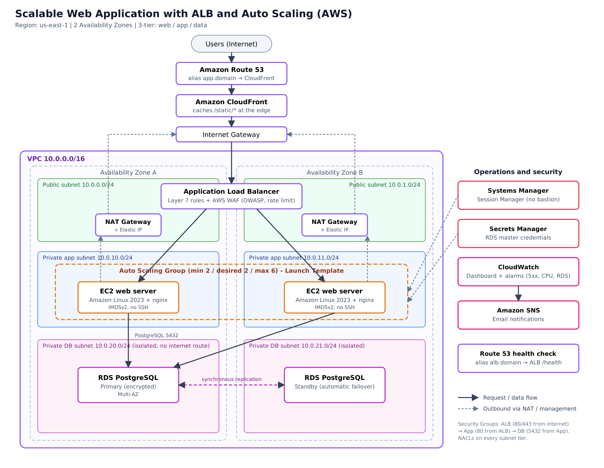
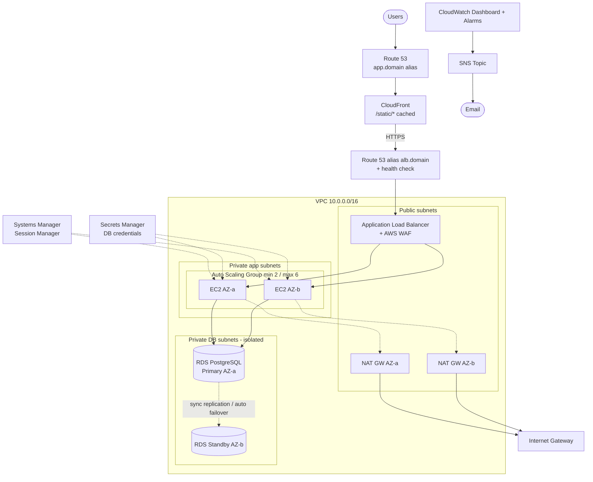

# Scalable Web Application with ALB and Auto Scaling (AWS SAA Graduation Project 1)

A highly available, auto-scaling, 3-tier web application on AWS, defined entirely as code (Terraform).
EC2 runs in **private subnets** across **two Availability Zones**, fronted by an **ALB + WAF** and **CloudFront**, backed by a **Multi-AZ RDS PostgreSQL**. No SSH, no bastion: access is via **Systems Manager Session Manager**.

## Architecture



<details><summary>Mermaid version (editable, renders on GitHub)</summary>



</details>

> Sources: [`docs/architecture.svg`](docs/architecture.svg) (editable in draw.io / Inkscape) and [`docs/architecture.mmd`](docs/architecture.mmd).

## Services and how they map to the project brief

| Brief requirement | Implementation | File |
|---|---|---|
| VPC, public/private subnets, 2 AZs | 2 public + 2 private-app + 2 private-db subnets, IGW, route tables | `vpc.tf` |
| NAT Gateway | One per AZ (HA); `single_nat_gateway=true` for cheap demos | `vpc.tf` |
| Security Groups | ALB → App → DB chain, each only accepts traffic from the previous tier | `security.tf` |
| NACLs | Custom stateless NACLs per tier (public / app / db) | `vpc.tf` |
| EC2 + ASG, Launch Template | AL2023, IMDSv2 only, encrypted gp3, min 2 / max 6, ELB health checks, rolling instance refresh | `asg.tf` |
| Scaling policies | Target tracking (CPU 50 %, 100 req/target) + step scaling (CPU ≥ 70 %) | `asg.tf` |
| ALB (Layer 7) | Listener rules (`/static/*`), target group health check `/health`, HTTP→HTTPS redirect when domain is set | `alb.tf` |
| WAF (OWASP Top 10) | AWS Managed Common, KnownBadInputs, SQLi, IP Reputation + rate limit 2000 req / 5 min / IP | `waf.tf` |
| CloudFront | Static assets cached (`CachingOptimized`), dynamic content passes through uncached | `cloudfront.tf` |
| RDS Multi-AZ | PostgreSQL 16, encrypted, auto failover, managed password in Secrets Manager, 7-day backups | `rds.tf` |
| Route 53 | Alias → ALB with health check; alias → CloudFront; ACM DNS validation (optional, needs a domain) | `dns.tf` |
| Systems Manager | `AmazonSSMManagedInstanceCore` role, no inbound SSH rule at all | `iam.tf` |
| CloudWatch + SNS | Dashboard, alarms (5xx, unhealthy hosts, CPU, RDS CPU/storage), email notifications | `monitoring.tf` |

## Repository structure

```
.
├── README.md
├── docs/architecture.png  (.svg, .mmd)
└── terraform/
    ├── versions.tf  variables.tf  outputs.tf
    ├── vpc.tf  security.tf  iam.tf
    ├── asg.tf  alb.tf  waf.tf
    ├── rds.tf  cloudfront.tf  dns.tf
    ├── monitoring.tf
    ├── user_data.sh.tpl
    └── terraform.tfvars.example
```

## Deploy

Prerequisites: Terraform ≥ 1.5, AWS CLI configured, the Session Manager plugin (for shell access).

```bash
cd terraform
cp terraform.tfvars.example terraform.tfvars   # edit alert_email, domain_name (optional)
terraform init
terraform plan
terraform apply
```

Takes ~15-20 minutes (RDS Multi-AZ and CloudFront are the slow parts). The app URL is printed as `app_url`.

## Verify (use these as screenshots / demo steps)

1. **Load balancing across AZs:** open `app_url` and refresh. The page shows the instance ID and AZ and should alternate.
2. **Caching:** `curl -sI https://<app_url>/static/style.css | grep -i x-cache` → first `Miss from cloudfront`, then `Hit from cloudfront`.
3. **WAF:** `curl -i "https://<app_url>/?q=<script>alert(1)</script>"` → `403`.
4. **Auto Scaling:** from a shell on one instance (`aws ssm start-session --target <instance-id>`) run `sudo dnf install -y stress-ng && stress-ng --cpu 0 --timeout 600`, then watch the ASG add instances in the dashboard.
5. **Self-healing:** terminate an instance in the console; the ASG launches a replacement.
6. **RDS failover:** RDS console → *Actions → Reboot → Reboot with failover*; the standby in the other AZ is promoted.
7. **No bastion:** Security Groups have no port 22 rule; access works only through Session Manager.

## Teardown

```bash
terraform destroy
```

## Cost note

NAT Gateways (~$0.045/h each), the ALB, and Multi-AZ RDS are the main costs. Run `terraform destroy` as soon as you finish recording your demo. Use `single_nat_gateway = true` to cut cost while testing.

## Design decisions and limitations

- The sample app is a static nginx page for demonstration; the DB is provisioned and reachable from the app tier (credentials in Secrets Manager, readable by the instance role) but the sample page does not query it. Replace `user_data.sh.tpl` with your real app bootstrap.
- Without `domain_name`, CloudFront → ALB uses HTTP (the default `*.cloudfront.net` certificate cannot be used for an ALB origin). Set a domain for end-to-end HTTPS.
- The ALB accepts traffic from the internet, so it can be reached directly, bypassing CloudFront. Hardening option: restrict the ALB SG to the CloudFront origin-facing managed prefix list.

## Learning outcomes covered

VPC / route table / NAT design · multi-AZ high availability · ALB listener rules and health checks · target tracking and step scaling · WAF + SG + private subnets · bastion-free access with Session Manager.
